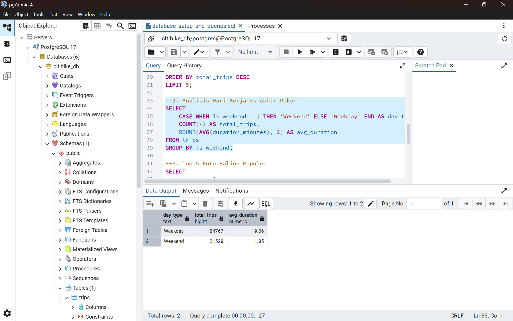
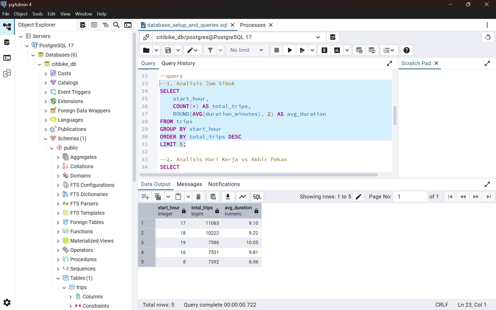
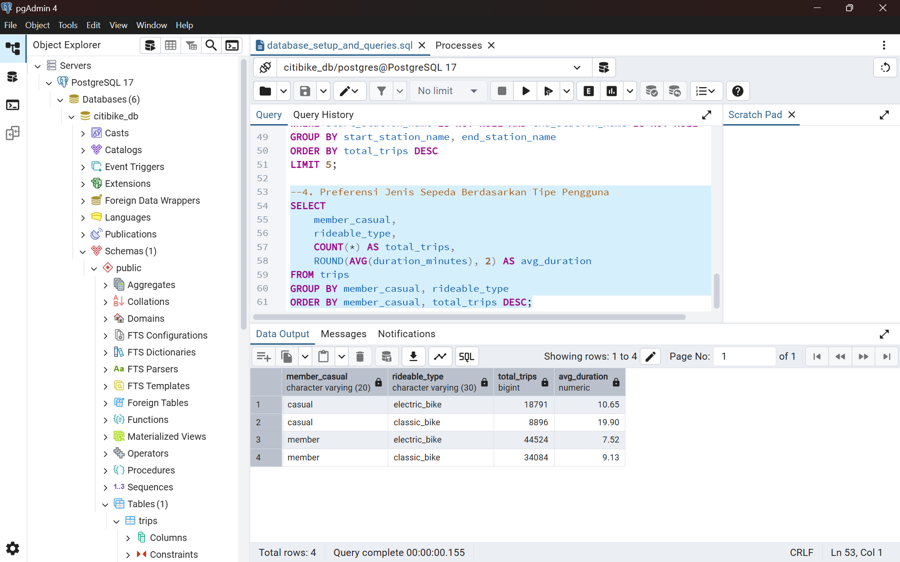
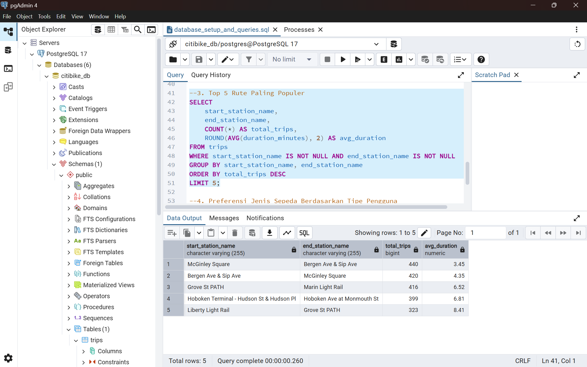

# 🚲 Jersey City Citi Bike: End-to-End Business Intelligence & Executive Dashboard

## 📌 Executive Summary
Proyek ini menganalisis data transaksi **Citi Bike di Jersey City** selama periode **September 2026** (106.295 transaksi). Tujuan utama analisis ini adalah untuk memahami pola penggunaan antara pengguna **Member** vs **Casual**, mengidentifikasi jam sibuk operasional (*peak hours*), serta memberikan rekomendasi bisnis untuk optimalisasi alokasi armada dan strategi konversi pengguna.

---

## 🛠️ Tech Stack & Tools
* **Relational Database**: PostgreSQL (pgAdmin 4) untuk penyimpanan data transaksi dan ekstraksi SQL (`database_setup_and_queries.sql`).
* **Data Cleaning & Processing**: Python (Pandas, NumPy) via VS Code.
* **Data Visualization & Dashboarding**: Tableau Public.
* **Version Control & Documentation**: Git & GitHub.

---

## 🗂️ Data Dictionary
Berikut adalah struktur tabel dari dataset transaksi Jersey City Citi Bike yang digunakan dalam *database* PostgreSQL:

| Nama Kolom | Tipe Data (SQL) | Deskripsi |
| :--- | :--- | :--- |
| `ride_id` | VARCHAR | ID unik untuk setiap transaksi penyewaan (Primary Key) |
| `rideable_type` | VARCHAR | Tipe sepeda yang disewa (*classic_bike* atau *electric_bike*) |
| `started_at` | TIMESTAMP | Tanggal dan waktu keberangkatan |
| `ended_at` | TIMESTAMP | Tanggal dan waktu tiba di tujuan |
| `start_station_name` | VARCHAR | Nama stasiun awal/keberangkatan |
| `end_station_name` | VARCHAR | Nama stasiun akhir/tujuan |
| `start_lat` / `start_lng` | NUMERIC | Titik koordinat (Latitude/Longitude) stasiun awal |
| `end_lat` / `end_lng` | NUMERIC | Titik koordinat (Latitude/Longitude) stasiun akhir |
| `member_casual` | VARCHAR | Tipe keanggotaan pengguna (*member* atau *casual*) |
| `duration_minutes` | NUMERIC | Total durasi perjalanan dalam hitungan menit (Hasil *Feature Engineering*) |
| `start_hour` | INTEGER | Jam keberangkatan dari 0-23 (Hasil *Feature Engineering*) |
| `is_weekend` | INTEGER | Indikator akhir pekan: 1 untuk Sabtu/Minggu, 0 untuk Hari Kerja (Hasil *Feature Engineering*) |

---

### 📸 Database Setup & SQL Execution
*(Cuplikan proses pembuatan skema database dan manipulasi data menggunakan PostgreSQL / pgAdmin 4)*
*(Analisis-Hari-Kerja-VS-Akhir-Pekan)*

*(Analisis-Jam-Sibuk)*

*(Preferensi-Jenis-Sepeda)*

*(Top-5-Rute-Paling-Populer)*

---

## 📊 Key Findings & Insights
1. **Pola Penggunaan & Demografi**: Transaksi didominasi oleh pengguna **Member**, tetapi pengguna **Casual** memiliki rata-rata durasi berkendara jauh lebih lama (~20 menit pada sepeda klasik) dibandingkan Member (~9 menit).
2. **Jam Sibuk Operasional (Peak Hours)**: Terjadi dua puncak lalu lintas perjalanan (*commuter peaks*) pada hari kerja, yaitu pukul **08.00 AM** (berangkat kerja) dan **17.00 – 18.00 PM** (pulang kerja).
3. **Stasiun Terpadat (Top Stations)**: Stasiun **Grove St PATH** mendominasi keberangkatan dengan volume tertinggi (4.807 perjalanan), disukai karena merupakan hub transit utama menuju NYC.

---

## 💡 Business Recommendations
* **Reokasi Armada Terjadwal (*Rebalancing*)**: Melakukan pengisian ulang sepeda listrik di stasiun hub utama (*Grove St PATH*) sebelum pukul 16.30 sore untuk mengantisipasi lonjakan jam pulang kerja.
* **Strategi Marketing Konversi Member**: Menargetkan pengguna *Casual* yang sering menggunakan sepeda klasik berdurasi panjang dengan promo khusus keanggotaan tahunan.
* **Pemeliharaan Rutin Unit Listrik**: Menjadwalkan pengisian daya baterai dan *maintenance* sepeda listrik pada jam sepi (23.00 – 05.00) agar armada siap 100% di jam puncak pagi.

---

## 🔗 Interactive Dashboard
Saksikan dan eksplorasi dashboard interaktif selengkapnya di Tableau Public:
👉 **[Klik di sini untuk membuka Dashboard Tableau Public](https://public.tableau.com/app/profile/muhammad.hilmi.fattah/viz/End-to-EndBusinessIntelligenceDashboarding/Dashboard1)**
